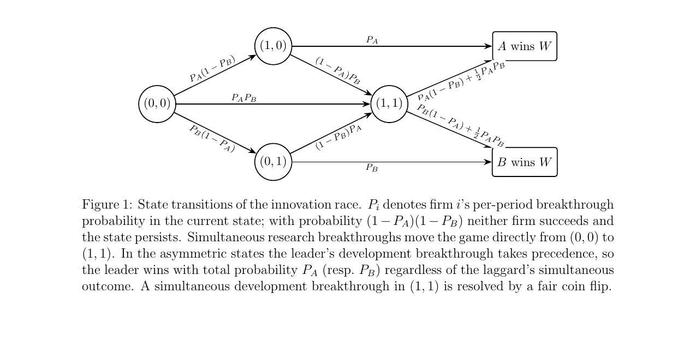
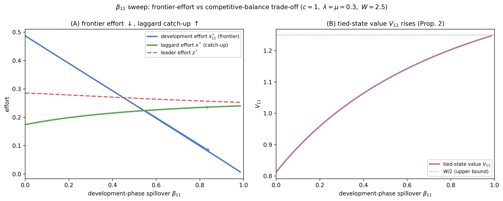
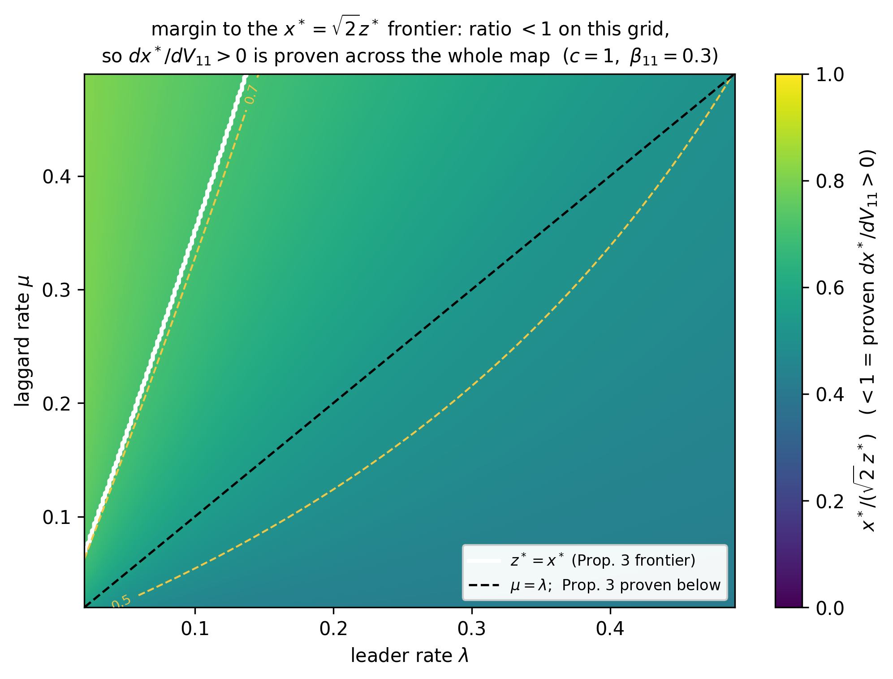
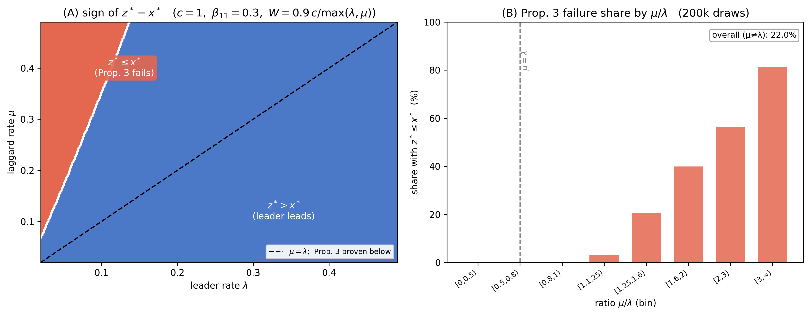
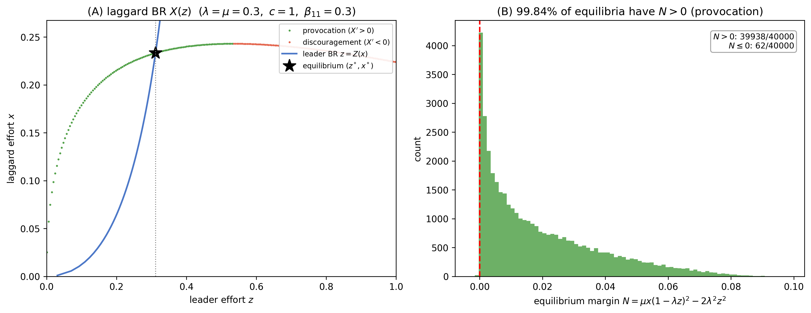

# Numerical Validation for my Honors Thesis

This repository is the numerical counterpart of my honors thesis: Trading Frontier
Effort for Competitive Balance: Knowledge Spillovers in a Two-Stage Innovation Race.
I check every closed form and comparative-static from my thesis using symbolic and numerical methods.

## Abstract

Rival firms racing to develop the same technology cannot fully contain what they
learn. I ask how involuntary knowledge spillovers reshape a winner-take-all innovation
race. I build a discrete-time dynamic contest in which two firms race through a
Research Stage and a Development Stage, with spillovers active only between firms
in the same stage. In the Markov Perfect Equilibrium, these spillovers work in two
ways: firms at the frontier free-ride on a rival’s effort and invest less, while the value
of reaching the frontier rises. Because spillovers are inactive when the race is asymmetric,
the laggard responds only to that anticipated value, and so fights harder when
there are higher spillovers at the frontier. I prove this transmission when the laggard’s
research rate does not exceed the leader’s development rate, and verify it beyond that
region against an independent numerical solution of the model. Spillovers therefore
trade frontier effort against competitive balance.

[Paper PDF](Ellahi_2026_Innovation_Race_Spillovers.pdf)

## Independent Checks

I check the `(1,1)` closed form against an independent Bellman and first-order-condition
solve using bisection. The asymmetric states use iteration of the derived best-response
formulas, and the initial state uses the derived equilibrium quadratic. All checks pass

- SymPy. Every algebraic identity simplifies to zero
- Finite differences. Comparative-statics checked at solved equilibria
- mpmath (50 digits). Flagged cases re-solved at higher precision.

## The model



Two firms race through two stages: research, then development. Each period a firm
breaks through with a probability that rises with its own effort and, through the
spillover `β`, with its rival's. Spillovers only work between firms in the same
stage — a firm still in research cannot absorb its rival's late-stage advances.
Both firms can break through in the same period, which sends the game straight from
`(0,0)` to `(1,1)`. A tie at the finish is a coin flip. Winner takes `W`. Effort
costs `c/2 · x²`.

## Trade-off



As the development-stage spillover `β₁₁`
rises, frontier effort `x₁₁*` falls — each firm free-rides on what spills over from
the other. But the value of being tied at the frontier, `V₁₁`, rises, and so does
the laggard's catch-up effort `x*`. Spillovers buy competitive balance and pay for
it in frontier effort.

The laggard gets nothing from the leader directly. Spillovers are switched off when
the race is asymmetric. It works harder only because the state it is racing toward
is worth more.

## Catch-up Theorem



The catch-up result `dx*/dV₁₁ > 0` is proven whenever the laggard's effort stays
below √2 times the leader's.

## Leader Dominance



The leader out-invests the laggard, `z* > x*`, whenever the laggard's research rate
does not exceed the leader's development rate (`μ ≤ λ`).

## Laggard's best response is not monotne.



Up to a threshold, a harder-working leader pushes the laggard to work harder rather
than discouraging it.

## Other

- `(1,1)` closed form against an independent Bellman + FOC solve: agrees to ~1e-14
- `(0,0)` state: `Δ₀ > 0` and `x₀₀* ∈ (0,1)` in all sampled draws, minimum `Δ₀ ≈ 0.021`
- laggard catch-up `dx*/dβ₁₁ > 0`: 100% of draws
- `det J > 0`: proven analytically, and 0 violations numerically
- the exact sign boundary for the leader's response `dz*/dβ₁₁` matches the numerics
  at all 40,000 scanned equilibria (`figs/dz_dbeta11_map_R4overlay.png`)
- initial-state regularity (`figs/task3_00_diagnostics.png`) and the `β₀₀` sweep
  (`figs/beta00_sweep.png`)

## Reproduce

```bash
pip install -r requirements.txt   # Python 3.10+
bash run_all.sh                   # ~90 seconds
```

Scans use a fixed seed, report sample size. Figures in `figs/`,
logs and tables in `numerics/`.

## Acknowledgement

I thank my advisor, Professor Luke Boosey, for his guidance on the model and the
proofs throughout this project.
